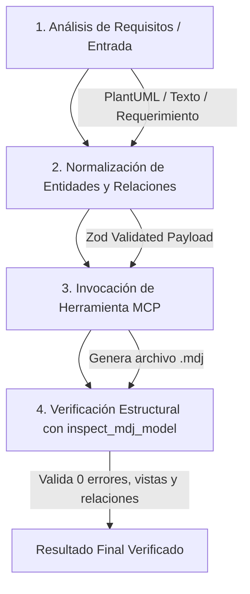

# Especialización en Diseño de Sistemas y Modelado UML (UML 2.5.1)

Esta skill capacita a cualquier agente de inteligencia artificial para concebir, modelar, validar y generar diagramas de ingeniería de software con rigor metodológico (UML 2.5.1 e ISO/IEC 19505), evitando los errores y antipatrones comunes en la diagramación automática.

---

## 1. Principios Fundamentales del Modelado de Sistemas

1. **Separación Estricta entre Semántica y Presentación Visual:**
   - Un elemento del modelo (ej. `UMLClass`, `UMLUseCase`, `UMLActor`) existe en el plano ontológico del sistema (`ownedElements`).
   - Una vista del elemento (ej. `UMLClassView`, `UMLUseCaseView`, `UMLActorView`) pertenece exclusivamente al lienzo gráfico (`ownedViews`).
   - Ninguna relación visual (`UMLAssociationView`, `UMLGeneralizationView`) puede flotar sin asociarse a nodos válidos (`head` y `tail`) y a su respectivo elemento semántico (`model`).

2. **Propósito y Nivel de Abstracción Adecuado:**
   - **Diagrama de Casos de Uso:** Modela el **QUÉ** hace el sistema desde la perspectiva de los actores externos (fronteras, metas observables, valor de negocio). *Nunca modela flujo de control ni algoritmos.*
   - **Diagrama de Actividades:** Modela flujos de trabajo, orquestación de procesos de negocio, concurrencia, ramificaciones y flujos de objetos/datos entre participantes (swimlanes).
   - **Diagrama de Máquina de Estados:** Modela el ciclo de vida reactivo de una entidad individual gobernada por eventos, estados discretos, guardas y transiciones.
   - **Diagrama de Secuencia:** Modela la dimensión temporal y el orden cronológico de intercambio de mensajes entre instancias/componentes para un escenario o caso de uso particular.
   - **Diagrama de Comunicación (Colaboración):** Modela la organización estructural de instancias y sus enlaces directos, anotados con mensajes ordenados numéricamente (1, 1.1, 2).
   - **Diagrama de Clases / Dominio:** Modela la estructura estática del dominio, tipos de datos, relaciones de acoplamiento, multiplicidades e invariantes.

---

## 2. Catálogo de Diagramas y Reglas Normativas

Consulta las guías de referencia detalladas para cada tipo de diagrama:

| Tipo de Diagrama | Guía Técnica Especializada | Propósito Primario |
| :--- | :--- | :--- |
| **Casos de Uso** | [`references/use-case-diagrams.md`](./references/use-case-diagrams.md) | Metas de actores externos, límites del sistema (`System Boundary`), relaciones `<<include>>`, `<<extend>>`. |
| **Actividades** | [`references/activity-diagrams.md`](./references/activity-diagrams.md) | Flujos operativos, nodos de decisión/unión, bifurcación/concurrencia (fork/join) y carriles (`swimlanes`). |
| **Máquinas de Estado** | [`references/state-machine-diagrams.md`](./references/state-machine-diagrams.md) | Ciclo de vida de entidades transaccionales, eventos desencadenantes, condiciones de guarda y transiciones. |
| **Secuencia** | [`references/sequence-diagrams.md`](./references/sequence-diagrams.md) | Interacciones cronológicas, llamadas sincrónicas/asincrónicas, respuestas, líneas de vida y fragmentos combinados. |
| **Comunicación / Colaboración** | [`references/communication-diagrams.md`](./references/communication-diagrams.md) | Enlaces estructurales entre instancias con secuenciación numérica de mensajes. |
| **Clases y Componentes** | [`references/class-and-component-diagrams.md`](./references/class-and-component-diagrams.md) | Estructura estática orientada a objetos, estereotipos, multiplicidades y 6 tipos de relaciones UML. |
| **Metamodelo StarUML (.mdj)** | [`references/staruml-mdj-metamodel.md`](./references/staruml-mdj-metamodel.md) | Especificación JSON de bajo nivel de StarUML, IDs de 24 caracteres, requerimientos de 11 subviews para asociaciones. |

---

## 3. Matriz de Errores Críticos y Antipatrones a Evitar

### ❌ Antipatrón 1: Casos de Uso como Pasos Algorítmicos
- **Error:** Crear casos de uso como "Ingresar Usuario", "Validar Contraseña", "Hacer Clic en Guardar".
- **Regla:** Un caso de uso representa un objetivo completo que otorga valor observable a un actor (ej. "Autenticar Usuario", "Registrar Incidencia"). Los pasos individuales pertenecen a una especificación de flujo o a un Diagrama de Actividades.

### ❌ Antipatrón 2: Inversión de Sentido en `<<include>>` y `<<extend>>`
- **Error:** Flecha de `include` apuntando del caso incluido al base, o flecha de `extend` apuntando del base a la extensión.
- **Regla Estricta:**
  - `A .> B : <<include>>`: **A incluye a B** (flecha de A hacia B). A siempre ejecuta B.
  - `E .> B : <<extend>>`: **E extiende a B** (flecha de la extensión E hacia el caso base B). E solo se ejecuta bajo condiciones específicas.

### ❌ Antipatrón 3: Desconexión Visual entre Actores y Casos de Uso en StarUML
- **Error:** Generar `UMLAssociationView` con etiquetas flotantes o apuntando a IDs erróneos, lo que provoca que StarUML descarte la línea y muestre los actores aislados en el lienzo.
- **Regla de Implementación:** Toda `UMLAssociationView` debe incluir sus 11 subviews normativos (`tailRoleNameLabel`, `headRoleNameLabel`, `tailMultiplicityLabel`, `headMultiplicityLabel`, `tailQualifiersCompartment`, etc.), donde los extremos del tail referencian a `end1` (`UMLAssociationEnd`) y los del head a `end2` (`UMLAssociationEnd`).

### ❌ Antipatrón 4: System Boundary Huérfano
- **Error:** Dibujar un rectángulo visual (`UMLUseCaseSubjectView`) sin un elemento de modelo semántico (`UMLUseCaseSubject`) en `UMLModel.ownedElements`.
- **Regla de Implementación:** StarUML descarta cualquier vista de contenedor que carezca de un nodo de modelo correspondiente. Ambos deben instanciarse y enlazarse mediante `$ref`.

### ❌ Antipatrón 5: Mensajes de Secuencia Fuera de Orden Cronológico
- **Error:** Líneas de mensajes que cruzan verticalmente hacia arriba o mensajes sin coordenada `y` monótonamente creciente.
- **Regla de Implementación:** El tiempo fluye exclusivamente de arriba hacia abajo. Cada mensaje debe tener un `top` o `location` superior al del mensaje anterior.

---

## 4. Pipeline de Generación con StarUML MCP

Cuando se interactúe con el servidor MCP de StarUML (`staruml`), seguir siempre este flujo de 4 fases:

1. **Normalización:**
   - Limpiar saltos de línea crudos en nombres (`\n` -> espacio o formato de etiqueta).
   - Resolver explícitamente `sourceId` y `targetId` para no generar referencias huérfanas.
   - Si los casos de uso pertenecen a un subsistema, definir `systemBoundary`.
2. **Cálculo de Layout:**
   - Para Casos de Uso: Layout `LR` (Left-to-Right) con actores en el extremo izquierdo y límites del sistema agrupando casos de uso en el centro/derecha.
   - Para Clases: Layout `TB` (Top-to-Bottom) con jerarquías de herencia e interfaces en niveles superiores.
   - Para Secuencia: Distribución horizontal equidistante de líneas de vida y vertical cronológica de mensajes.
3. **Generación Atómica:**
   - Escribir el archivo `.mdj` asegurando que todos los `$ref` sean resolubles internamente.
4. **Inspección Automática:**
   - Invocar inmediatamente `inspect_mdj_model` para auditar la cuenta de vistas, clases, relaciones y actores, certificando que ninguna conexión se haya perdido.
